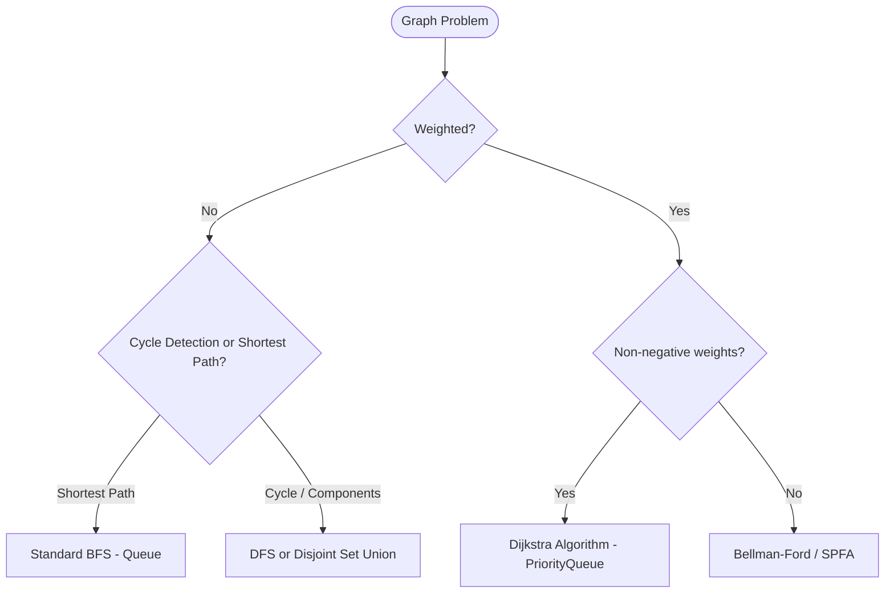
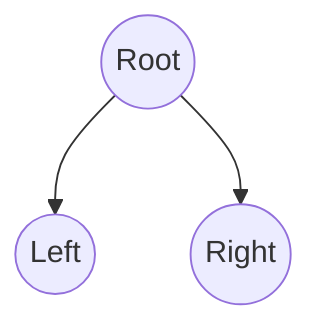

# DSA Master Cheat Sheet: Input Parsing, Optimal Solutions & Reusable Logics

A comprehensive reference for competitive programming, online assessments (OAs), technical interviews, and algorithmic problem-solving in **Java**.

---

## Table of Contents
1. [Input Parsing Masterclass (Scanner vs. Fast I/O)](#1-input-parsing-masterclass)
2. [Best Solutions & Optimizations for Repository Problems](#2-best-solutions--optimizations-for-repository-problems)
3. [Array Logics & Essential Patterns](#3-array-logics--essential-patterns)
4. [String Logics & Essential Patterns](#4-string-logics--essential-patterns)
5. [Matrix & 2D Grid Logics](#5-matrix--2d-grid-logics)
6. [Graph Algorithms & Reusable Templates](#6-graph-algorithms--reusable-templates)
7. [Tree Patterns & Traversals](#7-tree-patterns--traversals)
8. [Backtracking Skeleton](#8-backtracking-skeleton)
9. [Bit Manipulation Tricks](#9-bit-manipulation-tricks)

---

## 1. Input Parsing Masterclass

### 1.1 Scanner Tricks & Pitfalls

#### A. Flushing the Leftover Newline Buffer
When `sc.nextInt()` or `sc.next()` reads a token, the trailing `\n` remains in the input buffer. Calling `sc.nextLine()` immediately after will read an empty line.
```java
int n = sc.nextInt();
sc.nextLine(); // MUST consume newline before reading full lines!
String fullLine = sc.nextLine();
```

#### B. Direct Bracket & Comma Delimiter Trick
Instead of doing manual regex replacement on inputs like `[1,2,3,4]`, instruct Scanner to treat brackets and commas as whitespace:
```java
Scanner sc = new Scanner(System.in);
sc.useDelimiter("[\\[\\],\\s]+"); // Splits by brackets, commas, spaces

while (sc.hasNextInt()) {
    int val = sc.nextInt();
    // directly processes 1, 2, 3, 4!
}
```

#### C. Reading Until End-of-File (EOF)
```java
while (sc.hasNext()) {
    String token = sc.next();
}
// For integer streams:
while (sc.hasNextInt()) {
    int val = sc.nextInt();
}
```

---

### 1.2 Fast I/O Template (When Scanner is Too Slow)
`Scanner` uses synchronized buffers and heavy regex parsing. In problems with $N \ge 10^5$, `Scanner` can cause **Time Limit Exceeded (TLE)**. Use `BufferedReader` and `StringTokenizer` for $10\times$ speedup.

```java
import java.io.*;
import java.util.*;

public class FastIO_Template {
    static class FastScanner {
        BufferedReader br = new BufferedReader(new InputStreamReader(System.in));
        StringTokenizer st;

        String next() {
            while (st == null || !st.hasMoreTokens()) {
                try {
                    String line = br.readLine();
                    if (line == null) return null;
                    st = new StringTokenizer(line);
                } catch (IOException e) {
                    e.printStackTrace();
                }
            }
            return st.nextToken();
        }

        int nextInt() { return Integer.parseInt(next()); }
        long nextLong() { return Long.parseLong(next()); }
        double nextDouble() { return Double.parseDouble(next()); }

        String nextLine() {
            try {
                return br.readLine();
            } catch (IOException e) {
                return null;
            }
        }
    }

    public static void main(String[] args) {
        FastScanner fs = new FastScanner();
        PrintWriter out = new PrintWriter(new BufferedOutputStream(System.out));

        // Read N
        String first = fs.next();
        if (first == null) return;
        int n = Integer.parseInt(first);

        int[] arr = new int[n];
        for (int i = 0; i < n; i++) {
            arr[i] = fs.nextInt();
        }

        // Fast writing
        for (int x : arr) {
            out.print(x + " ");
        }
        out.println();

        // ALWAYS flush/close PrintWriter!
        out.flush();
        out.close();
    }
}
```

---

## 2. Best Solutions & Optimizations for Repository Problems

This section compares the solutions found in [javaCode](file:///e:/PSB/javaCode) with the industry-standard optimal approaches.

### 2.1 Contains Duplicate (LC 217)
- **Current Approach**: `HashSet<Integer>` tracking seen elements ($O(N)$ time, $O(N)$ space).
- **Pro Tip**: `seen.add(x)` returns `false` if `x` is already present. This avoids calling `contains()` followed by `add()`.
```java
// Optimal One-Liner check during insertion
Set<Integer> seen = new HashSet<>();
for (int num : nums) {
    if (!seen.add(num)) return true; // Already existed!
}
return false;
```
- **Small Value Range Alternative**: If $-10^5 \le nums[i] \le 10^5$, a `boolean[]` or `BitSet` with offset has $0$ object overhead and runs $5\times$ faster.

---

### 2.2 Valid Anagram (LC 242)
- **Current Approach**: `HashMap<Character, Integer>` count tracking.
- **Problem**: Boxing `Character` and `Integer` causes hash overhead and memory thrashing.
- **Optimal Approach**: `int[26]` frequency array ($O(N)$ time, $O(1)$ space, no object allocations).

```java
public boolean isAnagramOptimal(String s, String t) {
    if (s.length() != t.length()) return false;
    int[] count = new int[26];
    
    for (int i = 0; i < s.length(); i++) {
        count[s.charAt(i) - 'a']++;
        count[t.charAt(i) - 'a']--;
    }
    
    for (int c : count) {
        if (c != 0) return false;
    }
    return true;
}
```

---

### 2.3 Group Anagrams (LC 49)
- **Current Approach**: Sort character array and use `new String(chars)` as map key $\rightarrow O(N \cdot K \log K)$ where $K$ is string length.
- **Optimal Frequency Signature Key**: For very long strings, count frequencies and construct a character count key $\rightarrow O(N \cdot K)$.
```java
public List<List<String>> groupAnagramsOptimal(String[] strs) {
    Map<String, List<String>> map = new HashMap<>();
    for (String s : strs) {
        int[] count = new int[26];
        for (char c : s.toCharArray()) count[c - 'a']++;

        // Build unique key, e.g., "#1#0#2...#0"
        StringBuilder sb = new StringBuilder();
        for (int c : count) {
            sb.append('#').append(c);
        }
        String key = sb.toString();

        map.computeIfAbsent(key, k -> new ArrayList<>()).add(s);
    }
    return new ArrayList<>(map.values());
}
```

---

### 2.4 Subsets (LC 78)
- **Current Approach**: Cascading generation ($O(N \cdot 2^N)$).
- **Alternative 1: Backtracking (Standard Interview Preference)**:
```java
public List<List<Integer>> subsetsBacktracking(int[] nums) {
    List<List<Integer>> result = new ArrayList<>();
    backtrack(nums, 0, new ArrayList<>(), result);
    return result;
}

private void backtrack(int[] nums, int start, List<Integer> current, List<List<Integer>> result) {
    result.add(new ArrayList<>(current));
    for (int i = start; i < nums.length; i++) {
        current.add(nums[i]);
        backtrack(nums, i + 1, current, result);
        current.remove(current.size() - 1); // backtrack
    }
}
```
- **Alternative 2: Bitmask Generation ($2^N$ Subsets)**:
```java
public List<List<Integer>> subsetsBitmask(int[] nums) {
    int n = nums.length;
    int total = 1 << n; // 2^n
    List<List<Integer>> result = new ArrayList<>();
    for (int mask = 0; mask < total; mask++) {
        List<Integer> sub = new ArrayList<>();
        for (int i = 0; i < n; i++) {
            if ((mask & (1 << i)) != 0) sub.add(nums[i]);
        }
        result.add(sub);
    }
    return result;
}
```

---

### 2.5 Valid Sudoku (LC 36)
- **Current Approach**: 3 separate passes checking row duplicates, column duplicates, and box duplicates.
- **Optimal Single-Pass Bitmasking / 2D Arrays**: Verify row, column, and $3 \times 3$ box simultaneously in one loop.
```java
public boolean isValidSudokuOptimal(char[][] board) {
    int[] rows = new int[9];
    int[] cols = new int[9];
    int[] boxes = new int[9];

    for (int r = 0; r < 9; r++) {
        for (int c = 0; c < 9; c++) {
            if (board[r][c] == '.') continue;
            int val = board[r][c] - '1';
            int bit = 1 << val;
            int boxIdx = (r / 3) * 3 + (c / 3);

            if ((rows[r] & bit) != 0 || (cols[c] & bit) != 0 || (boxes[boxIdx] & bit) != 0) {
                return false;
            }

            rows[r] |= bit;
            cols[c] |= bit;
            boxes[boxIdx] |= bit;
        }
    }
    return true;
}
```

---

### 2.6 Maximum Depth of Binary Tree (LC 104)
- **Current Approach**: Recursive DFS (`1 + Math.max(left, right)`). Very concise ($O(N)$ time, $O(H)$ stack).
- **BFS Alternative (Level-Order / Avoids Deep Stack Overflow)**:
```java
public int maxDepthBFS(TreeNode root) {
    if (root == null) return 0;
    Queue<TreeNode> queue = new LinkedList<>();
    queue.offer(root);
    int depth = 0;

    while (!queue.isEmpty()) {
        int levelSize = queue.size();
        for (int i = 0; i < levelSize; i++) {
            TreeNode node = queue.poll();
            if (node.left != null) queue.offer(node.left);
            if (node.right != null) queue.offer(node.right);
        }
        depth++;
    }
    return depth;
}
```

---

### 2.7 Number of Islands (LC 200) & Flood Fill (LC 733)
- **Best Practice**: In-place sinking (`grid[r][c] = '0'`) saves an extra `boolean[][] visited` matrix.
- **Direction Trick**:
  - Instead of writing 4 separate recursive calls:
  ```java
  int[] DIR = {-1, 0, 1, 0, -1};
  for (int i = 0; i < 4; i++) {
      int nr = r + DIR[i], nc = c + DIR[i + 1];
      if (nr >= 0 && nr < rows && nc >= 0 && nc < cols && grid[nr][nc] == '1') {
          dfs(nr, nc, grid);
      }
  }
  ```

---

### 2.8 Rotting Oranges (LC 994)
- Multi-source BFS using `Deque<int[]>` is already optimal ($O(M \cdot N)$).
- **Optimization Tip**: Check `freshCount == 0` at the very start to immediately return `0` if no fresh oranges exist.

---

### 2.9 Graph Path & Connected Components (LC 1971 & LC 323)
- **Optimal Data Structure: Disjoint Set Union (DSU / Union-Find)**:
  - For static or dynamic edge lists, DSU answers connectivity in nearly $O(1)$ amortized time ($\alpha(N)$).
```java
static class DSU {
    int[] parent;
    int[] rank;
    int components;

    DSU(int n) {
        parent = new int[n];
        rank = new int[n];
        components = n;
        for (int i = 0; i < n; i++) parent[i] = i;
    }

    int find(int i) {
        if (parent[i] == i) return i;
        return parent[i] = find(parent[i]); // Path compression
    }

    boolean union(int i, int j) {
        int rootI = find(i);
        int rootJ = find(j);
        if (rootI == rootJ) return false;

        // Union by rank
        if (rank[rootI] < rank[rootJ]) parent[rootI] = rootJ;
        else if (rank[rootI] > rank[rootJ]) parent[rootJ] = rootI;
        else {
            parent[rootJ] = rootI;
            rank[rootI]++;
        }
        components--;
        return true;
    }

    boolean isConnected(int i, int j) {
        return find(i) == find(j);
    }
}
```
- **LC 323 countComponents in 3 lines**:
  ```java
  DSU dsu = new DSU(n);
  for (int[] edge : edges) dsu.union(edge[0], edge[1]);
  return dsu.components;
  ```
- **LC 1971 validPath in 3 lines**:
  ```java
  DSU dsu = new DSU(n);
  for (int[] edge : edges) dsu.union(edge[0], edge[1]);
  return dsu.isConnected(source, destination);
  ```

---

### 2.10 Sum of Subarray Ranges (LC 2104)
- **Current Approach**: $O(N^2)$ brute-force running min/max.
- **Optimal Approach: Monotonic Stack in $O(N)$**:
  $$\sum (\text{max} - \text{min}) = \sum (\text{Subarray Maximums}) - \sum (\text{Subarray Minimums})$$
```java
public long subArrayRangesOptimal(int[] nums) {
    return sumSubarrayMinsMaxs(nums, true) - sumSubarrayMinsMaxs(nums, false);
}

private long sumSubarrayMinsMaxs(int[] nums, boolean findMax) {
    int n = nums.length;
    long total = 0;
    Deque<Integer> stack = new ArrayDeque<>();

    for (int i = 0; i <= n; i++) {
        while (!stack.isEmpty() && (i == n || (findMax ? nums[stack.peek()] < nums[i] : nums[stack.peek()] > nums[i]))) {
            int mid = stack.pop();
            int left = stack.isEmpty() ? -1 : stack.peek();
            int right = i;
            long count = (long) (mid - left) * (right - mid);
            total += count * nums[mid];
        }
        stack.push(i);
    }
    return total;
}
```

---

## 3. Array Logics & Essential Patterns

### 3.1 Two Pointers

#### A. Opposite Ends (e.g., Two Sum II, Palindrome, Container With Most Water)
```java
int left = 0, right = arr.length - 1;
while (left < right) {
    int sum = arr[left] + arr[right];
    if (sum == target) {
        return new int[]{left, right};
    } else if (sum < target) {
        left++;
    } else {
        right--;
    }
}
```

#### B. Fast and Slow Pointers (e.g., Remove Duplicates, Cycle Detection)
```java
int slow = 0;
for (int fast = 0; fast < nums.length; fast++) {
    if (nums[fast] != val) {
        nums[slow++] = nums[fast];
    }
}
return slow;
```

---

### 3.2 Sliding Window

#### A. Fixed Size $K$
```java
int windowSum = 0;
for (int i = 0; i < k; i++) windowSum += arr[i];
int maxSum = windowSum;

for (int i = k; i < arr.length; i++) {
    windowSum += arr[i] - arr[i - k]; // Slide right: add new, subtract old
    maxSum = Math.max(maxSum, windowSum);
}
```

#### B. Dynamic Variable-Size Window Template
```java
int left = 0;
int maxLen = 0;
Map<Character, Integer> windowCounts = new HashMap<>();

for (int right = 0; right < s.length(); right++) {
    char c = s.charAt(right);
    windowCounts.put(c, windowCounts.getOrDefault(c, 0) + 1);

    // Contract window when condition violated
    while (windowConditionViolated(windowCounts)) {
        char leftChar = s.charAt(left);
        windowCounts.put(leftChar, windowCounts.get(leftChar) - 1);
        if (windowCounts.get(leftChar) == 0) windowCounts.remove(leftChar);
        left++;
    }

    maxLen = Math.max(maxLen, right - left + 1);
}
```

---

### 3.3 Prefix Sum (Range Queries in $O(1)$)
```java
int[] prefix = new int[n + 1];
for (int i = 0; i < n; i++) {
    prefix[i + 1] = prefix[i] + nums[i];
}

// Sum of nums[L...R] inclusive (0-indexed):
int rangeSum = prefix[R + 1] - prefix[L];
```

---

### 3.4 Kadane’s Algorithm (Maximum Subarray Sum)
```java
public int maxSubArray(int[] nums) {
    int maxSoFar = nums[0];
    int currentSum = nums[0];

    for (int i = 1; i < nums.length; i++) {
        currentSum = Math.max(nums[i], currentSum + nums[i]);
        maxSoFar = Math.max(maxSoFar, currentSum);
    }
    return maxSoFar;
}
```

---

### 3.5 Binary Search Variants

#### A. Lower Bound (First index where `arr[idx] >= target`)
```java
public int lowerBound(int[] arr, int target) {
    int low = 0, high = arr.length;
    while (low < high) {
        int mid = low + (high - low) / 2;
        if (arr[mid] >= target) high = mid;
        else low = mid + 1;
    }
    return low;
}
```

#### B. Upper Bound (First index where `arr[idx] > target`)
```java
public int upperBound(int[] arr, int target) {
    int low = 0, high = arr.length;
    while (low < high) {
        int mid = low + (high - low) / 2;
        if (arr[mid] > target) high = mid;
        else low = mid + 1;
    }
    return low;
}
```

#### C. Binary Search on Answer Template
Used for problems like "Koko Eating Bananas", "Capacity to Ship Packages within D Days", "Split Array Largest Sum":
```java
int low = minPossibleAnswer, high = maxPossibleAnswer;
int best = -1;

while (low <= high) {
    int mid = low + (high - low) / 2;
    if (isValid(mid, conditions)) {
        best = mid;
        high = mid - 1; // Try to minimize
    } else {
        low = mid + 1;
    }
}
return best;
```

---

### 3.6 Monotonic Stack (Next Greater Element)
```java
public int[] nextGreaterElement(int[] nums) {
    int n = nums.length;
    int[] nge = new int[n];
    Deque<Integer> stack = new ArrayDeque<>(); // Stores indices

    for (int i = n - 1; i >= 0; i--) {
        while (!stack.isEmpty() && nums[stack.peek()] <= nums[i]) {
            stack.pop();
        }
        nge[i] = stack.isEmpty() ? -1 : nums[stack.peek()];
        stack.push(i);
    }
    return nge;
}
```

---

## 4. String Logics & Essential Patterns

### 4.1 Frequency Array
For English lowercase characters `'a'` through `'z'`:
```java
int[] freq = new int[26];
for (char c : s.toCharArray()) freq[c - 'a']++;
```

### 4.2 Expand Around Center (Longest Palindromic Substring)
```java
public String longestPalindrome(String s) {
    if (s == null || s.length() < 1) return "";
    int start = 0, end = 0;

    for (int i = 0; i < s.length(); i++) {
        int len1 = expand(s, i, i);     // Odd length
        int len2 = expand(s, i, i + 1); // Even length
        int len = Math.max(len1, len2);

        if (len > end - start) {
            start = i - (len - 1) / 2;
            end = i + len / 2;
        }
    }
    return s.substring(start, end + 1);
}

private int expand(String s, int left, int right) {
    while (left >= 0 && right < s.length() && s.charAt(left) == s.charAt(right)) {
        left--;
        right++;
    }
    return right - left - 1;
}
```

### 4.3 Longest Substring Without Repeating Characters (LC 3)
```java
public int lengthOfLongestSubstring(String s) {
    int[] lastIndex = new int[128];
    Arrays.fill(lastIndex, -1);
    int maxLen = 0, start = 0;

    for (int i = 0; i < s.length(); i++) {
        char c = s.charAt(i);
        if (lastIndex[c] >= start) {
            start = lastIndex[c] + 1;
        }
        lastIndex[c] = i;
        maxLen = Math.max(maxLen, i - start + 1);
    }
    return maxLen;
}
```

---

## 5. Matrix & 2D Grid Logics

### 5.1 Standard Direction Vectors
```java
// 4-Directional: Up, Right, Down, Left
int[][] DIRS_4 = {{-1, 0}, {0, 1}, {1, 0}, {0, -1}};

// Compact 4-Directional Array
int[] DIR = {-1, 0, 1, 0, -1};
// Neighbor at index i: (r + DIR[i], c + DIR[i + 1])

// 8-Directional (includes diagonals)
int[][] DIRS_8 = {
    {-1, -1}, {-1, 0}, {-1, 1},
    {0, -1},           {0, 1},
    {1, -1},  {1, 0},  {1, 1}
};
```

### 5.2 Safe In-Bounds Check Helper
```java
private static boolean inBounds(int r, int c, int rows, int cols) {
    return r >= 0 && r < rows && c >= 0 && c < cols;
}
```

### 5.3 Multi-Source 2D BFS Template
Used for Rotting Oranges, 01 Matrix, Walls and Gates:
```java
public int[][] multiSourceBFS(int[][] grid) {
    int m = grid.length, n = grid[0].length;
    Queue<int[]> queue = new LinkedList<>();
    boolean[][] visited = new boolean[m][n];

    // 1. Add all initial sources to queue
    for (int r = 0; r < m; r++) {
        for (int c = 0; c < n; c++) {
            if (isSource(grid[r][c])) {
                queue.offer(new int[]{r, c});
                visited[r][c] = true;
            }
        }
    }

    int step = 0;
    int[] DIR = {-1, 0, 1, 0, -1};

    // 2. Expand outwards level by level
    while (!queue.isEmpty()) {
        int size = queue.size();
        for (int i = 0; i < size; i++) {
            int[] curr = queue.poll();
            int r = curr[0], c = curr[1];

            for (int d = 0; d < 4; d++) {
                int nr = r + DIR[d], nc = c + DIR[d + 1];
                if (nr >= 0 && nr < m && nc >= 0 && nc < n && !visited[nr][nc] && isValid(grid[nr][nc])) {
                    visited[nr][nc] = true;
                    queue.offer(new int[]{nr, nc});
                }
            }
        }
        step++;
    }
    return grid;
}
```

### 5.4 In-Place Matrix Rotation (Clockwise 90°)
```java
public void rotate(int[][] matrix) {
    int n = matrix.length;
    // Step 1: Transpose matrix (swap matrix[i][j] with matrix[j][i])
    for (int i = 0; i < n; i++) {
        for (int j = i + 1; j < n; j++) {
            int temp = matrix[i][j];
            matrix[i][j] = matrix[j][i];
            matrix[j][i] = temp;
        }
    }
    // Step 2: Reverse each row
    for (int i = 0; i < n; i++) {
        for (int j = 0; j < n / 2; j++) {
            int temp = matrix[i][j];
            matrix[i][j] = matrix[i][n - 1 - j];
            matrix[i][n - 1 - j] = temp;
        }
    }
}
```

---

## 6. Graph Algorithms & Reusable Templates



### 6.1 Adjacency List Construction
```java
// For N nodes (0 to N-1)
List<List<Integer>> adj = new ArrayList<>();
for (int i = 0; i < n; i++) adj.add(new ArrayList<>());

// Directed: u -> v
adj.get(u).add(v);

// Undirected: u <-> v
adj.get(u).add(v);
adj.get(v).add(u);
```

---

### 6.2 Topological Sort (Kahn's BFS Algorithm)
Detects cycles and orders DAG tasks:
```java
public int[] topologicalSort(int numCourses, int[][] prerequisites) {
    List<List<Integer>> adj = new ArrayList<>();
    int[] inDegree = new int[numCourses];
    for (int i = 0; i < numCourses; i++) adj.add(new ArrayList<>());

    for (int[] p : prerequisites) {
        int u = p[1], v = p[0];
        adj.get(u).add(v);
        inDegree[v]++;
    }

    Queue<Integer> queue = new LinkedList<>();
    for (int i = 0; i < numCourses; i++) {
        if (inDegree[i] == 0) queue.offer(i);
    }

    int[] order = new int[numCourses];
    int idx = 0;

    while (!queue.isEmpty()) {
        int curr = queue.poll();
        order[idx++] = curr;

        for (int neighbor : adj.get(curr)) {
            if (--inDegree[neighbor] == 0) {
                queue.offer(neighbor);
            }
        }
    }

    // If idx != numCourses, graph contains a cycle!
    return idx == numCourses ? order : new int[0];
}
```

---

### 6.3 Dijkstra's Algorithm (Shortest Path with Non-Negative Weights)
```java
static class Edge {
    int to, weight;
    Edge(int to, int weight) { this.to = to; this.weight = weight; }
}

public int[] dijkstra(int n, List<List<Edge>> adj, int src) {
    int[] dist = new int[n];
    Arrays.fill(dist, Integer.MAX_VALUE);
    dist[src] = 0;

    PriorityQueue<int[]> pq = new PriorityQueue<>(Comparator.comparingInt(a -> a[1]));
    pq.offer(new int[]{src, 0}); // {node, distance}

    while (!pq.isEmpty()) {
        int[] curr = pq.poll();
        int u = curr[0], d = curr[1];

        if (d > dist[u]) continue; // Stale entry

        for (Edge edge : adj.get(u)) {
            if (dist[u] + edge.weight < dist[edge.to]) {
                dist[edge.to] = dist[u] + edge.weight;
                pq.offer(new int[]{edge.to, dist[edge.to]});
            }
        }
    }
    return dist;
}
```

---

## 7. Tree Patterns & Traversals

### 7.1 Tree Traversals Summary



- **Preorder (Root, Left, Right)**: Serialization, copying trees.
- **Inorder (Left, Root, Right)**: Produces strictly sorted order for BSTs.
- **Postorder (Left, Right, Root)**: Deletion, bottom-up calculations (height, diameter).

### 7.2 Tree Diameter & Height (Single-Pass Bottom-Up)
```java
public class TreeDiameter {
    private int maxDiameter = 0;

    public int diameterOfBinaryTree(TreeNode root) {
        maxDiameter = 0;
        depth(root);
        return maxDiameter;
    }

    private int depth(TreeNode node) {
        if (node == null) return 0;
        int left = depth(node.left);
        int right = depth(node.right);

        // Path passing through this node
        maxDiameter = Math.max(maxDiameter, left + right);

        return 1 + Math.max(left, right);
    }
}
```

### 7.3 Lowest Common Ancestor (LCA)
```java
public TreeNode lowestCommonAncestor(TreeNode root, TreeNode p, TreeNode q) {
    if (root == null || root == p || root == q) return root;

    TreeNode left = lowestCommonAncestor(root.left, p, q);
    TreeNode right = lowestCommonAncestor(root.right, p, q);

    if (left != null && right != null) return root; // Split point
    return left != null ? left : right;
}
```

---

## 8. Backtracking Skeleton

Standard template for Subsets, Permutations, Combinations:
```java
private void backtrack(List<Item> candidates, int start, List<Item> path, List<List<Item>> results) {
    // 1. Goal / Base condition
    if (isGoal(path)) {
        results.add(new ArrayList<>(path));
        // return; // (if fixed length)
    }

    // 2. Iterate through candidate choices
    for (int i = start; i < candidates.size(); i++) {
        // Pruning / validity check
        if (!isValid(candidates.get(i))) continue;

        // Make choice
        path.add(candidates.get(i));

        // Recurse
        backtrack(candidates, i + 1, path, results); // i+1 for combinations, 0 for permutations

        // Undo choice (backtrack)
        path.remove(path.size() - 1);
    }
}
```

---

## 9. Bit Manipulation Tricks

| Operation | Expression | Explanation |
| :--- | :--- | :--- |
| **Check $k$-th bit** | `(n & (1 << k)) != 0` | Returns true if $k$-th bit is 1 |
| **Set $k$-th bit** | `n |= (1 << k)` | Turns $k$-th bit to 1 |
| **Clear $k$-th bit** | `n &= ~(1 << k)` | Turns $k$-th bit to 0 |
| **Toggle $k$-th bit** | `n ^= (1 << k)` | Flips $k$-th bit |
| **Clear lowest set bit** | `n &= (n - 1)` | Kernighan's trick to count set bits |
| **Extract lowest set bit** | `n & (-n)` | Isolates the rightmost set bit |
| **Check power of two** | `n > 0 && (n & (n - 1)) == 0` | True if $n = 2^x$ |
| **Swap without temp** | `a ^= b; b ^= a; a ^= b;` | In-place XOR swap |
| **Number of set bits** | `Integer.bitCount(n)` | Built-in instruction (Hamming weight) |
